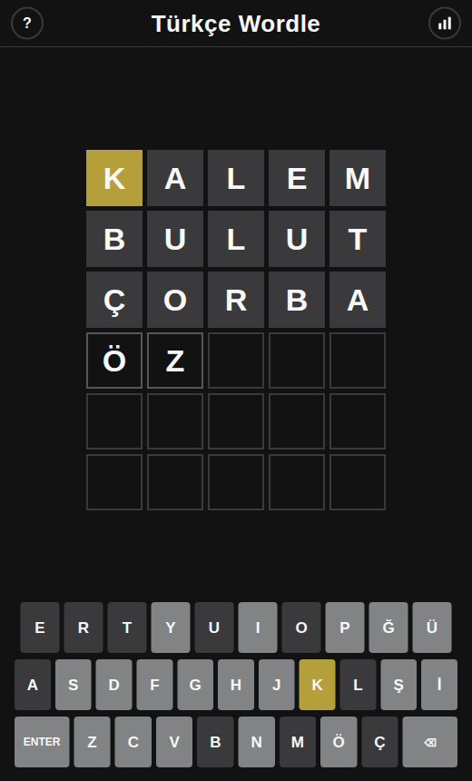

# Türkçe Wordle

Her gün yeni bir 5 harfli Türkçe kelime. 6 denemede bul, sonucunu renkli karelerle paylaş.

**[Hemen oyna](https://akintaha2010-cloud.github.io/turkce-wordle/)**: kurulum yok, telefonda da çalışır.



## Özellikler

- Türkçe Q klavye: Ç, Ğ, I, İ, Ö, Ş, Ü harfleri ekranda ve fiziksel klavyede
- I ile İ ayrı harfler, büyük harfe çevirme Türkçe kurallarına göre yapılır
- Her gün gece yarısı herkes için aynı kelime
- Tekrarlanan harfler Wordle kurallarıyla renklenir
- Spoiler'sız paylaşım: 🟩🟨⬛ kareleri panoya kopyalanır
- İstatistikler: oynanan oyun, kazanma oranı, seri, tahmin dağılımı (tarayıcıda saklanır)
- Yarım kalan oyun sayfa yenilenince kaldığı yerden devam eder

## Çalıştırma

Derleme adımı yok. ES modülleri kullandığı için yerel bir sunucuyla aç:

```bash
python3 -m http.server 8080
```

Ardından http://localhost:8080 adresine git.

## Testler

```bash
npm test
```

## Yapı

- `js/game.js`: puanlama, günün kelimesi, istatistik ve paylaşım metni (arayüzden bağımsız)
- `js/words.js`: cevap listesi (elle seçilmiş ~530 yaygın kelime) ve kabul edilen tahminler (~5200 kelime)
- `js/ui.js`: tahta, klavye, animasyonlar ve pencereler
- `tests/game.test.js`: kural testleri (`node:test`)

Tahmin listesi, [mertemin/turkish-word-list](https://github.com/mertemin/turkish-word-list) içindeki 5 harfli küçük harfli kelimelerden süzüldü.

## Lisans

MIT
